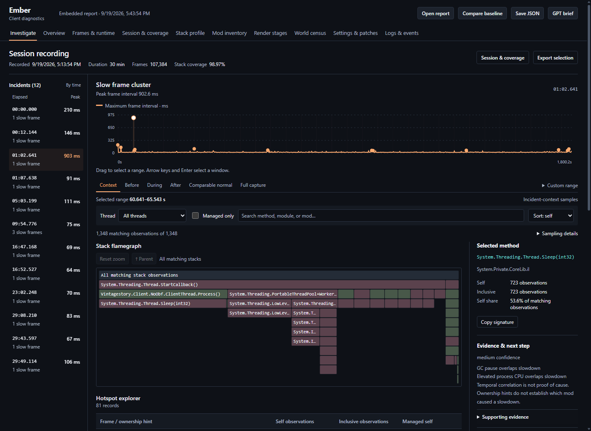

# Ember Diagnostics

**Record client performance in Vintage Story. Investigate stutters in a self-contained offline report.**

[Documentation](docs/README.md) · [Contributing](CONTRIBUTING.md) · [Issues](https://github.com/bbauti/ember/issues) · [Releases](https://github.com/bbauti/ember/releases) · [MIT license](LICENSE)

> **AI development disclosure:** This mod was written entirely with AI assistance using **OpenAI GPT-6 Astra** through OpenCode—including its implementation, viewer, tests and documentation. **bbauti** directs and maintains the project. This is not a claim of independent human code review. Read [AI_USAGE.md](AI_USAGE.md) for the development process, validation limits and contributor expectations.

Ember was motivated primarily by **[spark](https://spark.lucko.me/)** and **[Lithos Probe](https://mods.vintagestory.at/probe)**: make performance problems easier to record, inspect and discuss. It brings that workflow to Vintage Story's **client**, combining frame/runtime history, sampled managed stacks and mod context. See [motivation and credits](#motivation-and-credits).



*Actual 1.1.2 viewer displaying a historical 30-minute test recording with deliberately injected stalls. This is not an overhead benchmark. [Screenshot provenance and mobile view](docs/images/README.md).*

## At a glance

| | Current scope |
| --- | --- |
| Game target | Vintage Story **1.22.7** |
| Installation | **Client only**; no remote-server installation or administrator privilege required by Ember |
| Recording runtime | **.NET 10**, matching game architecture, with a discoverable `dotnet` host |
| Platform validation | Windows; Linux/macOS recording workflows have not been validated |
| Reports | Local HTML, JSON, Markdown, CSV and optional speedscope profile |
| Network / AI services | No automatic upload, telemetry backend or AI-service dependency |
| Maintenance | Community project maintained by [bbauti](https://github.com/bbauti) |

Start one recording, play normally, then stop or leave the world. Ember prepares a session bundle you can open from disk. The profiler helps find evidence and the next experiment; it does not prove which mod caused a slowdown.

Multiplayer use requires no Ember network packets or server command permission. Follow the rules of the server you join. In singleplayer, the integrated server shares the client process: process CPU, memory, GC and stack samples can include its work.

## Install

1. Obtain `emberdiagnostics-1.1.2.zip` from [GitHub Releases](https://github.com/bbauti/ember/releases), when published, or [build it from source](docs/development.md). GitHub's automatically generated **Source code** ZIP is not an installable mod.
2. Put the ZIP in the `Mods` directory of your Vintage Story **data** folder (normally `%APPDATA%\VintagestoryData\Mods` on Windows), then restart the client. Keep only one Ember version installed.
3. Join a world and run `.ember health`.
4. Session recording requires a matching-architecture **[.NET 10 runtime](https://dotnet.microsoft.com/en-us/download/dotnet/10.0)** and a discoverable `dotnet` host. The bundled `tracer/Ember.Trace.dll` is a framework-dependent worker; it launches separately and attaches to this client's PID through local .NET diagnostics IPC. See [runtime troubleshooting](docs/usage.md#troubleshooting) if startup fails.

The game installation directory used to **build** is different from the data directory used for **mods and exports**.

## Record a session

```text
.ember start
```

Play normally, then run **`.ember stop` or leave the world/server**. Ember automatically prepares one session ZIP in the background, and opens the export folder by default. Its standalone worker can finish after the client exits. Extract the ZIP and open **`report.html`**. For optional AI-assisted interpretation, **`GPT-REPORT.md`** is the single-file first attachment. No hosting, AI account or automatic upload is involved.

`.ember profile` with no argument starts the same session. For an optional timer, use `.ember profile 1800` for 30 minutes (accepted range: 5–28,800 seconds). No history configuration edit is needed. Untimed sessions have a default four-hour maximum and a 2 GiB disk budget; limits can finish a recording earlier.

| Command | Purpose |
| --- | --- |
| `.ember help` | Show available commands. |
| `.ember health` | Show a current client health snapshot. |
| `.ember start` | Start a session; save automatically on stop or world exit. |
| `.ember profile [seconds]` | Start the same session; optionally stop after 5–28,800 seconds. |
| `.ember stop` | Finish the active session and automatically export. |
| `.ember cancel` | Cancel the active recording. |
| `.ember status` | Show recording/finalization status. |
| `.ember export` | Export a recent monitoring snapshot; an active session keeps recording. |
| `.ember mark <text>` | Add a timestamped observation to the report timeline. |
| `.ember heapdump [note]` | Capture one heap dump during a recording: which owners retain managed memory. Manual only, and the walk can hitch the game briefly. |
| `.ember recover` | Retry unfinished recordings from saved journals/checkpoints. |
| `.ember folder` | Open the export folder. |

## What is collected

- During recording, per-second runtime/frame batches are journaled to disk across the session, rather than truncated to the recent 15-minute buffer. Final reports bound individual frames and stack observations and retain incident evidence; omissions and gaps are disclosed.
- Outside recording, lightweight monitoring keeps a rolling **15-minute** runtime timeline and up to **120,000 recent frame records** by default. High frame rates can exhaust the record cap sooner.
- Frame intervals and instrumented render/stage **wall times**, plus optional asynchronous GPU Before/Done elapsed timestamps. GPU timestamps include pipeline gaps, exclude earlier ticks and presentation, and are **not GPU busy time/utilization**; results arrive later.
- Process CPU in both one-core and machine-normalized units, working set/private/managed memory, allocation rate, GC and thread-pool context.
- CPU/GPU identity, OS/runtime, selected graphics settings, client-visible entity/chunk counts, meshing queues, received-byte counters, reported ping, and recent warnings/errors and timeline markers.
- Mod identities, versions, dependencies, systems, associated assemblies, optional file hashes, and Harmony patch inventory. Inventory and sampled module matches are evidence for investigation, not proof a mod caused a stall.
- A heap dump **only** when `.ember heapdump` is requested during a recording. The report keeps per-owner retained bytes, the largest holder roots and types, the bytes no owner could be attributed to, and whether the capture was complete. The raw trace is deleted as soon as it has been reduced, object addresses and field values are never exported, and nothing is captured between dumps. Every request appears in the report and in `SUMMARY.md`, including refusals and failures: a dump that stopped records `failureKind` and names the limit that stopped it — a filled EventPipe buffer, the object budget, or the dump's own time budget, whose capture and reduction allowances the report states — and one whose totals are a lower bound says so. A dump that never produced a heap still marks the event timeline where it ended.
- Session managed-stack segments (60 seconds and up to 50,000 retained observations per segment by default), with coverage, rundown/parse status and quality metadata. Attachment and segment transitions can leave gaps; continuous stack coverage is not guaranteed. **Sample percentages are thread observations, not exact CPU percentages.**

Optional mod configuration collection is **off by default** (`IncludeModConfigs=false`). If enabled, configurations pass through redaction. Logs and markers can still contain identifying information: review the files before sharing them. See [data and metric semantics](docs/metrics-and-data.md) for interpretation and sharing details.

## Exports

Bundles are written under `<DataPath>/Ember/exports/`:

| File | Contents |
| --- | --- |
| `GPT-REPORT.md` | Single-file first attachment for GPT: selected evidence, session/incident context, limitations and analysis instructions. |
| `report.html` | Self-contained offline viewer with embedded report data. |
| `report.json` | Structured report, metric definitions, timeline, inventory and limitations. |
| `llm-context.json` | Compact context: environment/settings, mods, selected worst windows and top stacks, with links to full evidence. |
| `SUMMARY.md` | Human-readable summary and evidence-based findings. |
| `ASK-AN-LLM.md` | Analysis instructions to accompany the report when asking an LLM for help. |
| `metrics.csv` | Runtime and frame distributions over time. |
| `frames.csv` | Individual retained frame intervals and render-submission wall times. |
| `incidents.csv` | Detected incident windows, severity evidence and stack coverage. |
| `manifest.json` | Export file sizes and SHA-256 hashes. |
| `profile.speedscope.json` | Per-thread sampled profile, present when a profile was captured. |

The HTML template is embedded in `Ember.Core.dll`; users do not need a separate viewer download or web server. Attach `GPT-REPORT.md` with what you did and when. Keep `report.json` available for deeper investigation—it contains the retained evidence and can be large. The other summaries remain useful supplementary files. Open the speedscope file in [speedscope](https://www.speedscope.app/) for a dedicated stack viewer.

Interrupted recordings are saved under `<DataPath>/Ember/sessions/`; startup recovery and `.ember recover` retry unfinished reports. Recovery can salvage complete journal batches and usable segments, but cannot guarantee the final moments of a crash.

### Investigate in the offline viewer

The **Investigate** workspace combines an incident queue with a stack laboratory. It opens the incident with the largest recorded frame peak and its surrounding context. Choose another incident in the queue or on the session timeline; filter by thread, managed classification, method/module/mod, and **Context / Before / During / After / Comparable normal**.

The recording header identifies the capture date, duration, observed frames and stack coverage. The compact range/source strip stays beside the filters; **Sampling details** explains time boundaries, sample density and graph/export semantics.

- Select a flame-graph branch to zoom and inspect its method. The method inspector shows the full signature, ownership hints, self/inclusive observations and self share. The paginated hotspot table and expandable call tree use the same filtered sample set.
- Expand supporting evidence, counter-evidence and next experiments beside the stacks. The main thread is labelled when its OS thread ID was captured.
- Drag the timeline, select a window with the arrow keys and Enter, or enter a custom interval. Time coordinates share the profile origin; end boundaries are exclusive.
- **Export selection** saves `ember-selection.json` with matching observations, frame definitions, filters, time origin and incident evidence. Search includes entire stacks containing a matching frame; flame zoom changes only the displayed branch. **GPT brief** remains the primary full-report handoff.
- Overview, runtime/GPU charts, baseline comparison, session coverage, inventory and full-capture allocation/exception/contention tools remain available in the report navigation.

An older exported HTML keeps its embedded viewer. To inspect an older capture in the new interface, open its `report.json` in the updated viewer; there is no need to record again.

## Build

Prerequisites: **.NET 10 SDK**, a local **Vintage Story 1.22.7** installation, and network access for initial NuGet restore. The Bash script also needs Python 3.

```powershell
./scripts/build.ps1 -GamePath 'C:\path\to\Vintagestory'
```

```bash
bash scripts/build.sh --game-path "$HOME/vintagestory"
```

Both scripts accept `-GamePath`; path resolution is explicit argument, then `VINTAGE_STORY`, then `APPDATA/Vintagestory` when `APPDATA` exists. They build Release/net10.0, publish the framework-dependent worker, stop on failures, and take the package version from `src/Ember.Mod/modinfo.json`. Output: `artifacts/emberdiagnostics-<version>.zip`.

Package root: `modinfo.json`, `Ember.dll`, `Ember.Core.dll`, `.ignore`, documentation and licenses, plus `tracer/` with the worker's complete publish output. The `.ignore` rule keeps worker DLLs out of Vintage Story's mod-assembly scan. Game assemblies are excluded. See [build and verification](docs/verification.md) for the release validation procedure and recorded status.

## Review the code

| Path | Responsibility |
| --- | --- |
| `src/Ember.Mod/` | Client hooks, commands, snapshots, GPU timing and recording lifecycle |
| `src/Ember.Core/` | Bounded collection, data models, journals, analysis, redaction and exports |
| `src/Ember.Trace/` | External EventPipe supervisor, segment capture, parsing and recovery |
| `viewer/report.html` | Dependency-free offline HTML/CSS/JavaScript viewer embedded in the core assembly |
| `tests/` | Executable regression and integration harnesses |
| `scripts/` | Local packaging and graphical game-test runners |

Start with the [architecture and reading map](docs/architecture.md), then [development setup](docs/development.md) and [testing guide](docs/testing.md). The game-independent checks and synthetic viewer tests can be run without a game installation:

```text
dotnet run --project tests/Ember.Tests/Ember.Tests.csproj -c Release
dotnet run --project tests/Ember.Session.Tests/Ember.Session.Tests.csproj -c Release
node viewer/verify.cjs
```

The viewer checks need Node.js 22+ and Chrome/Chromium (`CHROME_PATH` can select the browser). Public CI exercises game-independent code and the viewer; packaging and gameplay validation require a local game installation. These suites are console programs, not `dotnet test` projects.

### Validation and known limits

- A historical 1.1.0 Windows/loopback multiplayer run recorded **30 minutes**, **107,384 frames** and **98.97% usable stack interval coverage**. Version 1.1.2 reuses that capture for viewer validation; it did not receive a new gameplay soak.
- The viewer regression suite includes hostile text, old/new/empty reports, keyboard interactions and a **400,000-sample / 200,000-frame** stress fixture.
- A representative, controlled overhead benchmark remains outstanding. Sampling and collection consume resources; Ember does not promise zero overhead.
- Sample shares are thread observations, **not exact CPU time**. GPU elapsed timestamps are **not utilization**. Module ownership and temporal overlap are **not proof of cause**. Retained-memory figures come from one heap snapshot and show which owner **holds** an object, not which mod caused memory to grow; a long heap-walk span does not prove the game was stopped. The runtime answers every EventPipe session that attaches while a walk is being captured with a complete walk of the heap, so a dump that spans several attaches carries the same heap several times over; the analysis collapses those copies onto the first walk and reports the walked count alongside, so the totals describe the heap once.
- Remote-server internals are unavailable. Linux/macOS game workflows and public-server network/authentication conditions remain unvalidated.

See the [full verification record](docs/verification.md). Raw private captures and generated binaries are intentionally excluded from Git.

## Motivation and credits

**[spark](https://spark.lucko.me/)**, by lucko and contributors, and **[Lithos Probe](https://mods.vintagestory.at/probe)**, by imtsubaki, were the **principal motivations for Ember**.

- **spark** demonstrated the value of an accessible capture workflow, runtime context and a rich profiler viewer. [Documentation](https://spark.lucko.me/docs/) · [Source](https://github.com/lucko/spark).
- **Lithos Probe** brought a packaged profiling/report workflow to Vintage Story servers and motivated a complementary client-focused tool. [Mod page](https://mods.vintagestory.at/probe) · [Source](https://github.com/trevorftp/LithosProbe).

Ember is an independent implementation, not a port or fork of either project; no spark or Lithos Probe code is copied or distributed. Their authors are not responsible for Ember. See [research and comparisons](docs/comparison.md) and [third-party notices](THIRD_PARTY_NOTICES.md) for additional sources and distributed dependency licenses.

## Contribute and get help

Bug reports, code review, documentation corrections and reproducible measurements are welcome. Read [CONTRIBUTING.md](CONTRIBUTING.md), then use [Issues](https://github.com/bbauti/ember/issues) or a pull request. Report sensitive vulnerabilities through the process in [SECURITY.md](SECURITY.md). Community participation follows our [code of conduct](CODE_OF_CONDUCT.md).

**All original project code and documentation were written with AI assistance using OpenAI GPT-6 Astra.** Please read the [full disclosure](AI_USAGE.md) before evaluating or contributing to the project.

## License

[MIT](LICENSE), copyright © 2026 Ember contributors. Third-party components retain their own licenses and notices. Vintage Story is copyright Anego Studios; Ember is an independent community project and does not distribute the game. A licensed game installation is required to build and run the mod.
